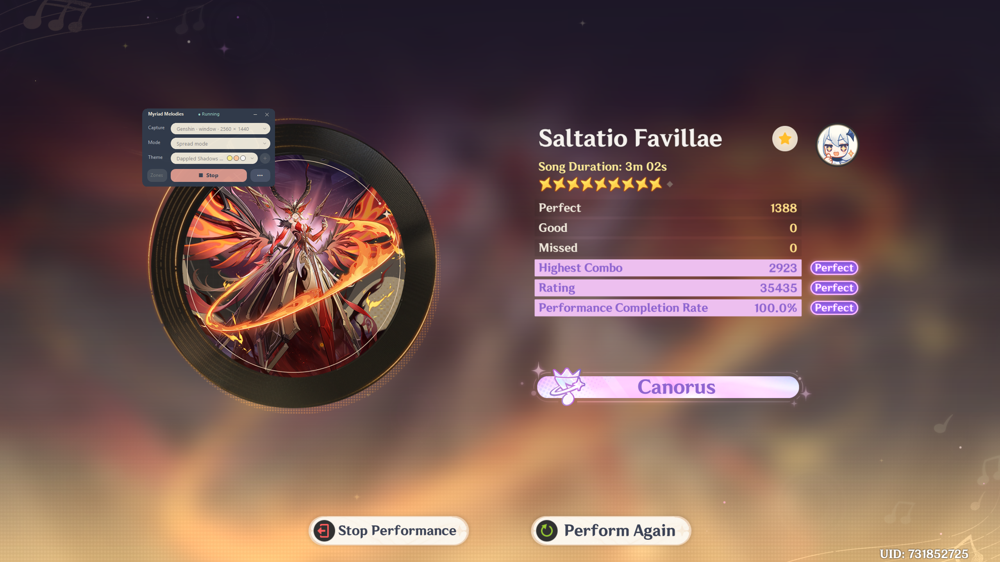
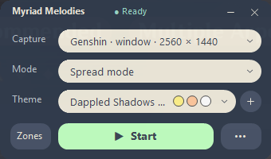
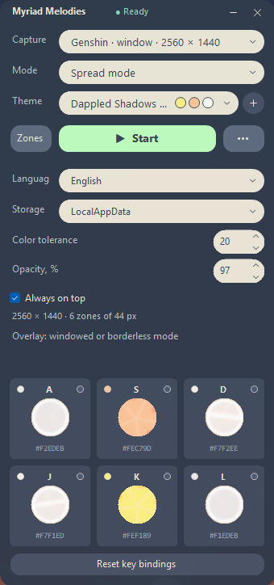

# MyriadMelodies

[Русский](README.md) · **English**



A compact assistant for the Genshin Impact rhythm game. It captures the game window or a display, detects note colors in six regions and presses your assigned keys. It does not read the game's memory.



## Download

Two options are available in [Releases](https://github.com/NikitaRe99/MyriadMelodies/releases):

- **[Full version](https://github.com/NikitaRe99/MyriadMelodies/releases/latest/download/MyriadMelodies-standalone-win-x64.exe)** — works without installing .NET.
- **[Compact version](https://github.com/NikitaRe99/MyriadMelodies/releases/latest/download/MyriadMelodies-runtime-required-win-x64.exe)** — requires [.NET Desktop Runtime 10 x64](https://dotnet.microsoft.com/en-us/download/dotnet/10.0).

Both versions run on Windows x64: Windows 10 version 2004 or later, or Windows 11.

## Features

- Vertical and spread modes.
- Region layouts for 16:9, 21:9, 16:10 and 4:3.
- 25 built-in themes, custom theme creation/editing and reordering.
- Per-region key bindings with a reset to A/S/D/J/K/L.
- Live region, average color and key-state previews.
- English/Russian UI, adjustable opacity and an always-on-top window.
- Settings in LocalAppData or beside the EXE.

## Getting started

1. Run the game in windowed or borderless mode.
2. Select the Genshin window or a display, then choose the mode and theme that match the game.
3. Click **Start** and return to the game. Key presses pause while the game is inactive; **Stop** ends capture.
4. Open **Zones** and click a region card to change its key binding.
5. Click **+** to add a theme and follow the instructions. The pencil in the list opens editing; drag themes to reorder them.

The first launch is compact, with settings and zones hidden. Click **…** to open settings. The initial UI language follows Windows: Russian for a Russian system UI and English for other languages.

## Settings and portability

**Storage** lets you choose **LocalAppData** (`%LOCALAPPDATA%\MyriadMelodies`) or **Beside EXE**. Switching copies your preferences, key bindings, themes and theme order. Previous copies are kept. To move a portable setup, copy the whole app folder, including its JSON files and the `MyriadMelodies.portable` marker.

## Screenshots

Settings and zone previews:



## Building from source

Use the .NET 10 SDK on Windows:

```powershell
dotnet build MyriadMelodies.sln -c Release
./tools/Test-Project.ps1
./tools/Publish.ps1
```

[Build and distribution](docs/DISTRIBUTION.md) · [Region geometry](docs/CAPTURE-RESOLUTIONS.md) · [MIT license](LICENSE)

MyriadMelodies is an independent tool. Genshin Impact and game assets belong to their respective owners.

## Thanks

If you'd like to say thanks in-game — **UID 731852725**.
