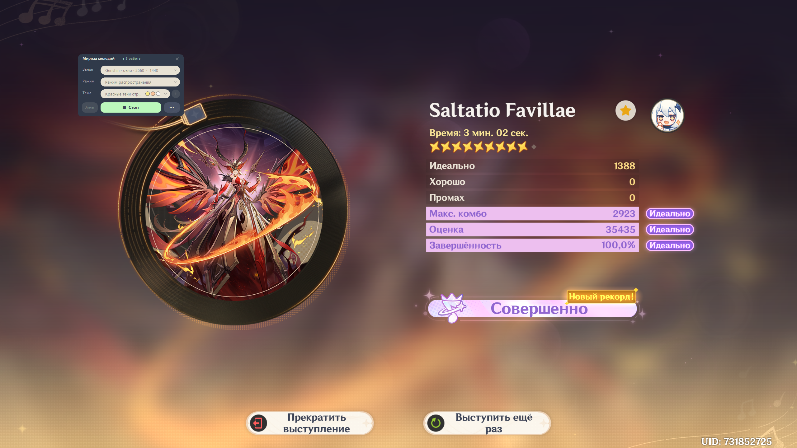
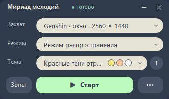
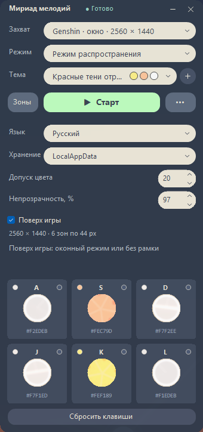

# MyriadMelodies

**Русский** · [English](README.en.md)



Компактный помощник для ритм-игры в Genshin Impact. Приложение захватывает окно игры или экран, распознаёт цвета нот в шести зонах и нажимает назначенные клавиши. Чтение памяти игры не используется.



## Скачать

В [Releases](https://github.com/NikitaRe99/MyriadMelodies/releases) есть два варианта:

- **[Полная версия](https://github.com/NikitaRe99/MyriadMelodies/releases/latest/download/MyriadMelodies-standalone-win-x64.exe)** — работает без установки .NET.
- **[Компактная версия](https://github.com/NikitaRe99/MyriadMelodies/releases/latest/download/MyriadMelodies-runtime-required-win-x64.exe)** — требуется [.NET Desktop Runtime 10 x64](https://dotnet.microsoft.com/en-us/download/dotnet/10.0).

Обе версии — для Windows x64: Windows 10 версии 2004 или новее либо Windows 11.

## Возможности

- Два режима: вертикальный и режим распространения.
- Расчёт зон для 16:9, 21:9, 16:10 и 4:3.
- 25 встроенных тем, добавление и редактирование своих, изменение порядка.
- Назначение клавиш для каждой зоны и сброс к A/S/D/J/K/L.
- Предпросмотр зон, среднего цвета и состояния нажатия.
- Русский и английский интерфейс, прозрачность и окно поверх игры.
- Хранение настроек в LocalAppData или рядом с EXE.

## Как пользоваться

1. Запустите игру в оконном режиме или без рамки.
2. Выберите окно Genshin или монитор, затем режим и тему, совпадающие с игрой.
3. Нажмите «Старт» и вернитесь в игру. Нажатия приостанавливаются, когда игра неактивна; «Стоп» завершает захват.
4. Чтобы переназначить клавиши, откройте «Зоны» и нажмите нужную карточку.
5. Для своей темы нажмите «+» и следуйте инструкции. Карандаш в списке открывает редактирование; темы можно перетаскивать.

Первый запуск компактный — настройки и зоны скрыты. Настройки открываются кнопкой «…». Язык первого запуска выбирается по Windows: русский для русского интерфейса системы, английский — для остальных языков.

## Настройки и перенос

В поле «Хранение» можно выбрать **LocalAppData** (`%LOCALAPPDATA%\MyriadMelodies`) или **«Рядом с EXE»**. При переключении копируются параметры, клавиши, темы и их порядок. Предыдущие копии сохраняются. Для переноса переносимой версии скопируйте всю папку программы с JSON-файлами и маркером `MyriadMelodies.portable`.

## Скриншоты

Настройки и предпросмотр зон:



## Исходники

Для сборки нужен .NET 10 SDK под Windows:

```powershell
dotnet build MyriadMelodies.sln -c Release
./tools/Test-Project.ps1
./tools/Publish.ps1
```

[Сборка и распространение](docs/DISTRIBUTION.md) · [Геометрия зон](docs/CAPTURE-RESOLUTIONS.md) · [Лицензия MIT](LICENSE)

MyriadMelodies — независимый инструмент. Genshin Impact и игровые материалы принадлежат их правообладателям.

## Благодарность

Если хотите поблагодарить в игре — **UID 731852725**.
